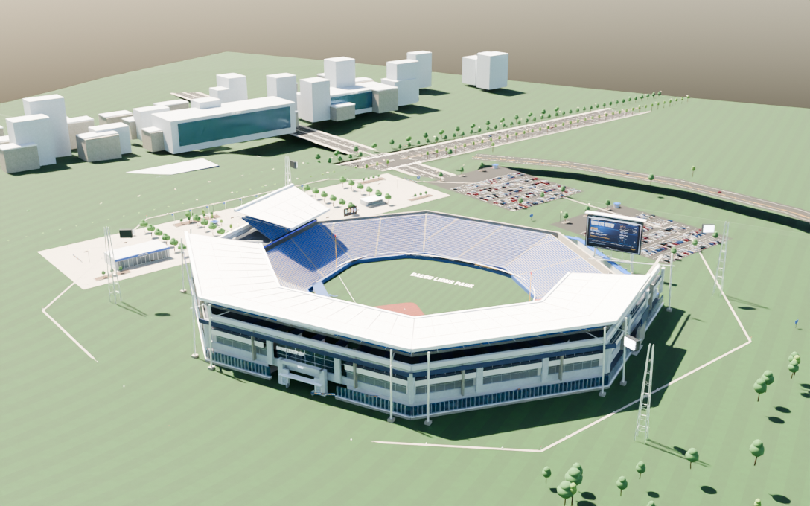
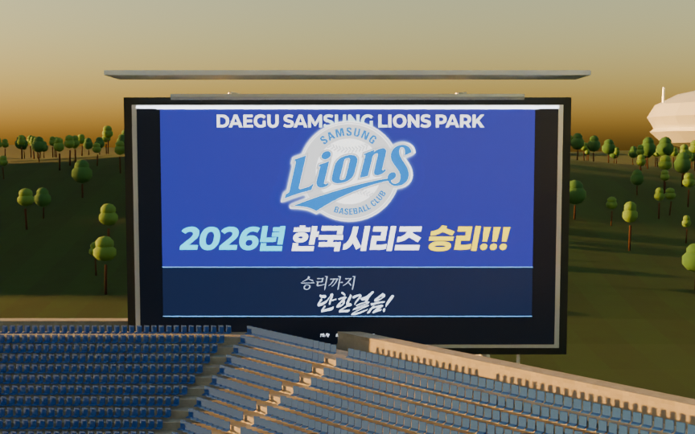
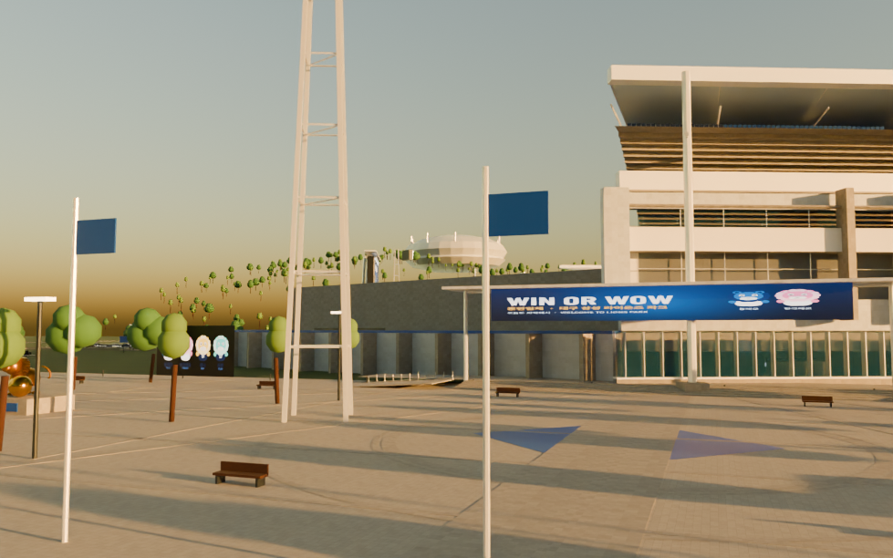
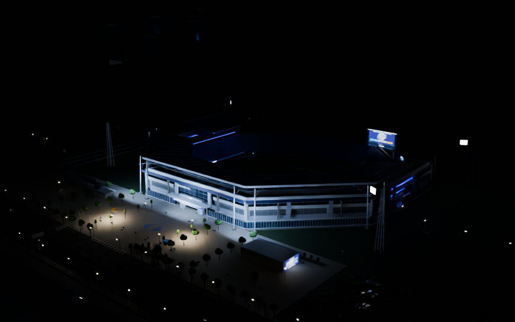
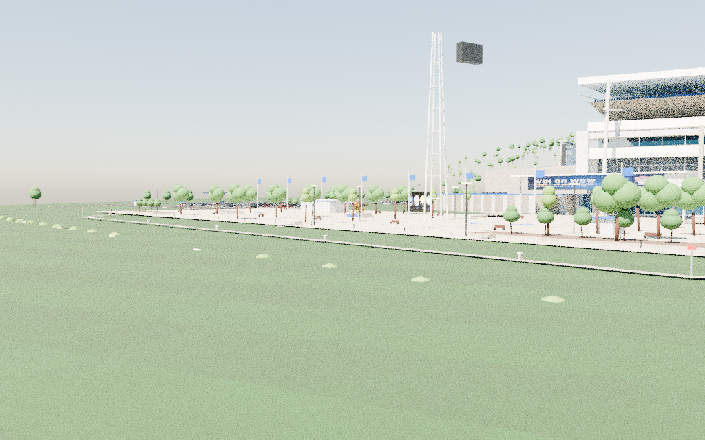
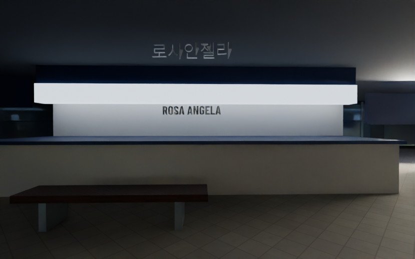

<p align="center">
  <br />
  <h1 align="center">🦁 라팍 오브 바모스 · Lions Park of VAMOS</h1>
  <p align="center">
    <strong>대구 삼성 라이온즈 파크와 그 일대를 브라우저 안으로 옮긴 3D 디지털 트윈</strong><br />
    <strong>그리고 그 옆에서 함께 목청을 높이는 실시간 웹 응원관</strong>
  </p>
  <p align="center">
    <a href="https://vamoslionspark.rhee.life/"></a>
  </p>
  <p align="center">
    
    
    
    
    
    
  </p>
  <br />
</p>

<p align="center">
  
</p>

> **WIN OR WOW — 라팍 v6.** <https://vamoslionspark.rhee.life/> 주소가 이 저장소의 **공식 라이브 쇼케이스**입니다.
> Cloudflare 순수 정적 자산 배포(`out/` 그대로) 위에서 14.6 MB Draco GLB와 Three.js가 즉시 구동됩니다.

---

## 📌 프로젝트 소개 · Overview

**Lions Park of VAMOS**는 삼성 라이온즈 팬들이 만든 **비공식 한국형 3D 오픈소스 프로젝트**입니다.

Blender 4.2로 절차적으로 다시 지은 대한민국 유일의 팔각 다이아몬드 구장 **라팍(대구 삼성 라이온즈 파크)** 과 151,526 ㎡ 실측 대지, 달구벌대로 10차선, 대공원역 4·5번 출구 일대를 Three.js로 걸어 다니고 차량으로 주행할 수 있습니다. 또한 같은 사이트의 실시간 응원관에서는 접속한 팬들과 함께 응원 카운트와 응원 동작을 실시간으로 나눌 수 있습니다.

### 🌟 핵심 특징 (Key Highlights)

- 🏟️ **라팍월드 (`/lionspark`)** — 14.6 MB Draco GLB, 10,403개 OBB 충돌체, 모델 좌석 39,845석, WASD 보행 및 3인칭 차량 주행
- 🏆 **WIN OR WOW & 혼연일체** — 2026 공식 캐치프레이즈를 36 m × 20.4 m 초대형 메인 LED 월(실전 7회말 스코어보드 레이아웃)·외야 펜스 뮤럴·게이트에 완벽 매핑
- 📐 **지적도 151,526.00 ㎡ & 동북동(67.5°) 필드 축** — 대지면적 151,526 ㎡ 정팔각형 대지 경계석·16시 이후 3루 홈 블루존 그늘 고증·펜스 99.5/123.4/122.5 m·국내 최단 18.3 m 필드석 (`docs/gis/`)
- 🏢 **라팍 공식 스폰서 8종 & 블레오 패밀리** — DGB대구은행(iM뱅크)·POSCO·삼성생명·삼성화재·Galaxy·에버랜드·참소주·금복주 호딩과 블레오·핑크레오·레니·라온 마스코트
- 🚶 **경기장 안쪽 콘코스 회랑** — 걷는 1·2층 회랑과 계단, 땅땅치킨·로사안젤라·라팍 편의점, 블루존/익사이팅존 구역 표지판, 21개 VIP 스위트 통유리, 덕아웃 벤치와 배트 거치대
- 🛣️ **주변 지리와 10m 표고차** — 야구전설로 1 도로명판, 달구벌대로 EL 35m에서 광장 EL 45m로 오르는 10m 대계단(44단), 연호지 수면, 수성알파시티 타워 9동, 연호산 능선(+74m), 대구스타디움 원경
- 🅿️ **지상 P1~P3 주차장 852면** — 실제 라팍 지상 주차면수(852면)와 100% 일치하는 지상 주차 구획과 주차 차량
- 💙 **실시간 응원관 (`/main`)** — WebSocket 기반 응원 카운트 및 춤 동작(폴짝폴짝/손흔들기/응원) 실시간 동기화, 유리 엠블럼 시네마 화면
- 🌅 **대구 위경도 천체 대기 산란** — 대구(35.84°N, 128.68°E) 기준 태양 궤적 계산, 🌅 일출(태양 5°)·☀️ 낮·🌇 노을(태양 8°)·🌙 밤 원클릭 시간대 전환
- 🐳 **자체 호스팅 100% 보장** — Docker, Node 독립 서버, VPS, Nginx, Vercel, Cloudflare, GitHub Pages 어디서나 1분 만에 배포

---

## 📸 3D 월드 갤러리 · Preview Gallery

|             🏟️ 주간 전경 & 수성알파시티 원경             |                   🏆 WIN OR WOW 36m 실전 전광판                    |
| :------------------------------------------------------: | :----------------------------------------------------------------: |
|  |  |
|         **🌇 노을지는 야구전설로 광장 & 게이트**         |                 **🌙 야간 라이팅 & 조명탑 풀가동**                 |
|  |          |
|           **🚶 달구벌대로 10m 대계단 진입로**            |                **🏪 1·2층 콘코스 회랑 & 편의시설**                 |
|    |    |

---

## 🧭 목차 · Table of Contents

1. [실측 고증 및 지리 데이터](#-실측-고증-및-지리-데이터)
2. [30초 만에 내 사이트로](#-30초-만에-내-사이트로)
3. [화면 구성 및 콘텐츠](#-화면-구성-및-콘텐츠)
4. [조작법 (Controls)](#-조작법-controls)
5. [시스템 아키텍처](#-시스템-아키텍처)
6. [로컬 개발 환경](#-로컬-개발-환경)
7. [호스트별 배포 가이드](#-호스트별-배포-가이드)
8. [블렌더 절차적 생성 파이프라인](#-블렌더-절차적-생성-파이프라인)
9. [저장소 디렉터리 구조](#-저장소-디렉터리-구조)
10. [라이선스 및 크레딧](#-라이선스-및-크레딧)

---

## 📐 실측 고증 및 지리 데이터

라팍 v6는 실제 대구삼성라이온즈파크의 토목·건축 허가 데이터와 구장 공식 요강을 정밀 대조하여 절차적으로 재현했습니다.

| 구분            | 공식 스펙 및 고증 수치                   | 3D 모델링 반영 내용                                                      |
| --------------- | ---------------------------------------- | ------------------------------------------------------------------------ |
| **대지 면적**   | 151,526.00 ㎡                            | 정팔각형 대지 경계석(34m 간격) & 코너 측량핀, 지적도 안내판(`docs/gis/`) |
| **필드 방위축** | **동북동 67.5° (ENE)**                   | 홈플레이트→센터 방향. 오후 4시 이후 3루 홈 응원석 전석 그늘 형성 고증    |
| **펜스 규격**   | 좌우 99.5m / 좌우중 123.4m / 중앙 122.5m | 팔각 펜스 라인 및 3.6m 펜스 높이, 홈런 경계선 완벽 일치                  |
| **필드석 거리** | **18.3 m**                               | 1·3루 베이스에서 파울라인 평행 18.3m 국내 최단거리 익사이팅존 3열 시공   |
| **표고차 (EL)** | 플랫폼 EL 45m / 달구벌대로 EL 35m        | 10m 높이 단차를 연결하는 대계단 44단 (3단계 참 구획)                     |
| **주차 면수**   | 지상 852면 (총 1,097대 중 지상)          | P1·P2·P3 지상 주차 구획 852면 정확 절차 배치                             |
| **전광판**      | 36 m × 20.4 m (우익수 뒤편 동남동)       | 3루 홈 관람석에서 직시하도록 배치, WIN OR WOW 실전 스코어보드 텍스처     |

---

## 🚀 30초 만에 내 사이트로

**개인 계정이나 특정 클라우드에 묶여 있지 않습니다.** 클론 후 즉시 독립 서버로 띄울 수 있습니다:

### Docker로 실행 (가장 빠름)

```sh
git clone https://github.com/hslcrb/lionsparkofvamos.git
cd lionsparkofvamos
docker compose up --build
# → http://localhost:8080 접속
```

### Node.js로 실행 (Node 22+)

```sh
npm ci
npm run build
node server/standalone.mjs
# → http://localhost:8080 (정적 에셋 서빙 + 실시간 WebSocket 응원방)
```

정적 호스팅(Vercel, Cloudflare Pages, GitHub Pages, S3, Nginx)에는 `npm run build`로 생성된 `out/` 폴더만 업로드하면 즉시 작동합니다. 자세한 내용은 **[DEPLOYMENT.md](DEPLOYMENT.md)** 를 참고하세요.

---

## 🎮 화면 구성 및 콘텐츠

### 1. `/` — 라이온즈 블루 입구

메시 그라데이션과 유리 질감으로 빚어낸 미니멀한 입구 화면입니다.

- **메인으로 바로 접속**: 실시간 웹 응원관으로 이동
- **라팍월드 들어가기**: 3D 디지털 트윈 경기장으로 입장

### 2. `/main` — 실시간 웹 응원관

접속한 팬들과 함께 목청을 높이는 인터랙티브 응원 공간입니다.

- 0.25초 간격으로 전체 누적 응원 횟수 실시간 반영
- 3대 응원 모션(**폴짝폴짝 / 손 흔들기 / 신나게 응원**)을 0.5초 주기로 방 전체 동기화
- 은은한 유리 엠블럼과 3초 페이드인 '나의 라이온즈' 응원 음원 플레이어 제공

### 3. `/lionspark` — 3D 라팍월드

브라우저에서 100% 로컬 계산되는 오픈월드 경기장입니다.

- 광장 게이트 2 중앙 통로를 통해 그라운드로 입장
- 달구벌대로에 주차된 차량에 탑승하여 10차선 대로와 주차장 드라이빙 가능
- 🌅 일출, ☀️ 주간, 🌇 노을, 🌙 야간 4대 조명 프리셋 원클릭 전환

---

## 🕹️ 조작법 (Controls)

| 동작                 | 키보드 조작                 | 모바일 터치           |
| -------------------- | --------------------------- | --------------------- |
| **이동**             | `W` `A` `S` `D` 또는 방향키 | 가상 조이스틱 패드    |
| **전력 질주**        | `Shift` 키 (12 m/s)         | 달리기 토글 버튼      |
| **차량 탑승 / 하차** | 차량 근처에서 `E` 키        | 차량 탑승/하차 아이콘 |
| **차량 가속 · 후진** | `W` / `S`                   | 가상 패드 상 / 하     |
| **차량 조향**        | `A` / `D`                   | 가상 패드 좌 / 우     |
| **핸드 브레이크**    | `Space` 바                  | 제동 버튼             |
| **카메라 뷰 전환**   | 3인칭 뷰 / 광장 복귀 버튼   | 화면 상단 HUD 버튼    |

---

## 🏗️ 시스템 아키텍처

```
[클라이언트 브라우저]
   │  정적 HTML · JS · GLB (14.6MB) · 텍스처
   ▼
[정적 자산 계층] ── out/ (Next.js 16 Static Export)
   │  /api/room (WebSocket 프로토콜, 선택)
   ▼
[응원 동기화 계층] ── ① Cloudflare Durable Object (CheerRoom)
                     ② 내장 Node.js 경량 서버 (standalone.mjs)
                     ③ 정적 전용 모드 (로컬 화면 반응)
```

- **Next.js 16 App Router + TypeScript (Strict)**: `output: 'export'` 정적 빌드 채택. 서버 사이드 렌더링 비용 0원 실현.
- **Three.js (r187) + Draco Mesh Compression**: 7만 개 이상의 지오메트리를 14.6MB 단일 GLB로 압축해 2초 내 첫 렌더 완료.
- **OBB 충돌 물리 엔진**: 공간 분할 해시를 적용한 10,403개 회전 바운딩 박스로 벽 뚫림 현상 완전 방지.

---

## 💻 로컬 개발 환경

```sh
# 저장소 클론 및 패키지 설치
git clone https://github.com/hslcrb/lionsparkofvamos.git
cd lionsparkofvamos
npm ci

# Cloudflare Workers 로컬 에뮬레이션 (포트 8787)
npm run local

# 내장 Node.js 서버 테스트 (포트 8080)
npm run build && npm run serve

# 전체 검증 스크립트 실행 (타입체크 + 린트 + 테스트 59건 + 빌드)
npm run check
```

---

## 🌐 호스트별 배포 가이드

| 호스팅 플랫폼               | 3D 경기장 | 실시간 응원 동기화 | 상세 배포 가이드                                                                 |
| --------------------------- | :-------: | :----------------: | -------------------------------------------------------------------------------- |
| **Docker / Compose**        |    ✅     |         ✅         | [DEPLOYMENT.md §1](DEPLOYMENT.md#1-docker--가장-빠른-자체-호스팅)                |
| **Node.js / VPS / NAS**     |    ✅     |         ✅         | [DEPLOYMENT.md §2](DEPLOYMENT.md#2-nodejs-서버--vps--nas)                        |
| **Cloudflare Workers**      |    ✅     |         ✅         | [DEPLOYMENT.md §3](DEPLOYMENT.md#3-cloudflare-workers--원래-구성본인-계정)       |
| **Cloudflare Pages / 정적** |    ✅     |   ⚠️ (로컬 반응)   | [DEPLOYMENT.md §5](DEPLOYMENT.md#5-cloudflare-pages--netlify--s3-등-정적-호스트) |
| **Vercel**                  |    ✅     |   ⚠️ (로컬 반응)   | [DEPLOYMENT.md §4](DEPLOYMENT.md#4-vercel)                                       |
| **GitHub Pages**            |    ✅     |   ⚠️ (로컬 반응)   | [DEPLOYMENT.md §6](DEPLOYMENT.md#6-github-pages)                                 |
| **Nginx 정적 웹서버**       |    ✅     |   ⚠️ (로컬 반응)   | [DEPLOYMENT.md §7](DEPLOYMENT.md#7-정적-nginx)                                   |

---

## 🎨 블렌더 절차적 생성 파이프라인

외부 에셋 다운로드 없이, 파이썬 스크립트 단 2개로 모든 텍스처와 3D 모델을 처음부터 절차적으로 빌드합니다:

```sh
# 1. WIN OR WOW, 혼연일체, 스폰서 호딩, 마스코트 텍스처 자동 생성
python3 scripts/prepare-v6-graphics.py

# 2. Blender 헤드리스 모드로 3D 라팍 v6 빌드 및 GLB 익스포트
blender --background --python assets/blender/lionspark_v6_build.py
```

자세한 블렌더 노드 구조 및 Unity/Unreal 호환 내보내기 방법은 **[BLENDER_GUIDE.md](BLENDER_GUIDE.md)** 에 상세히 기술되어 있습니다.

---

## 📁 저장소 디렉터리 구조

```
lionsparkofvamos/
├── assets/
│   ├── blender/          # v6 빌드 스크립트, .blend 씬, 텍스처, 폰트, 프리뷰 렌더
│   └── graphics/         # 삼성 라이온즈 승리 그래픽 원본 자산
├── deploy/               # Nginx 정적 설정 템플릿
├── docs/                 # 지적도 고증 문서 (docs/gis/), 디자인 매뉴얼
├── public/
│   ├── draco/            # Three.js Draco 지오메트리 디코더
│   └── models/           # 14.6MB Draco GLB, OBB 충돌체 JSON, 지적 JSON
├── scripts/              # 텍스처 생성기 및 로컬 통합 검증 스크립트
├── server/               # 의존성 0개 독립 Node.js 정적+WebSocket 서버
├── src/
│   ├── app/              # Next.js 16 라우트 (/, /main, /lionspark, /418)
│   ├── components/       # 응원 UI, 음악 플레이어, HUD 컴포넌트
│   └── features/         # 3D 물리 엔진, 지형 인덱스, 천체 시뮬레이션
├── worker/               # Cloudflare Workers 및 CheerRoom Durable Object
├── Dockerfile            # 멀티스테이지 초경량 프로덕션 이미지
├── docker-compose.yml    # 1초 원클릭 로컬 컨테이너 기동
├── DEPLOYMENT.md         # 7대 호스팅 플랫폼별 배포 매뉴얼
└── BLENDER_GUIDE.md      # 3D 모델 수정 및 게임 엔진 연동 가이드
```

---

## 📜 라이선스 및 크레딧

- **소스 코드 및 3D 기하 모델**: [MIT License](LICENSE) · Copyright (c) 2026 Lions Park of VAMOS contributors.
- **삼성 라이온즈 구단 상표·마스코트·응원가 음원**: 원 저작권자에게 귀속되며, 본 프로젝트는 비영리 비공식 팬 프로젝트 목적으로만 활용됩니다. (상세: [NOTICE.md](NOTICE.md))
- **폰트**: Noto Sans KR (SIL OFL 1.1), Barlow Condensed (SIL OFL 1.1).
- **HDRI 하늘 및 텍스처**: Poly Haven (CC0).
- **Draco 3D 압축**: Apache License 2.0.

---

<p align="center">
  <strong>승리를 위해 다 함께 외쳐라! 최강 삼성 라이온즈! 🦁💙🤍</strong><br />
  <em>라팍 현장에서, 그리고 웹 브라우저 안에서. VAMOS!</em>
</p>
